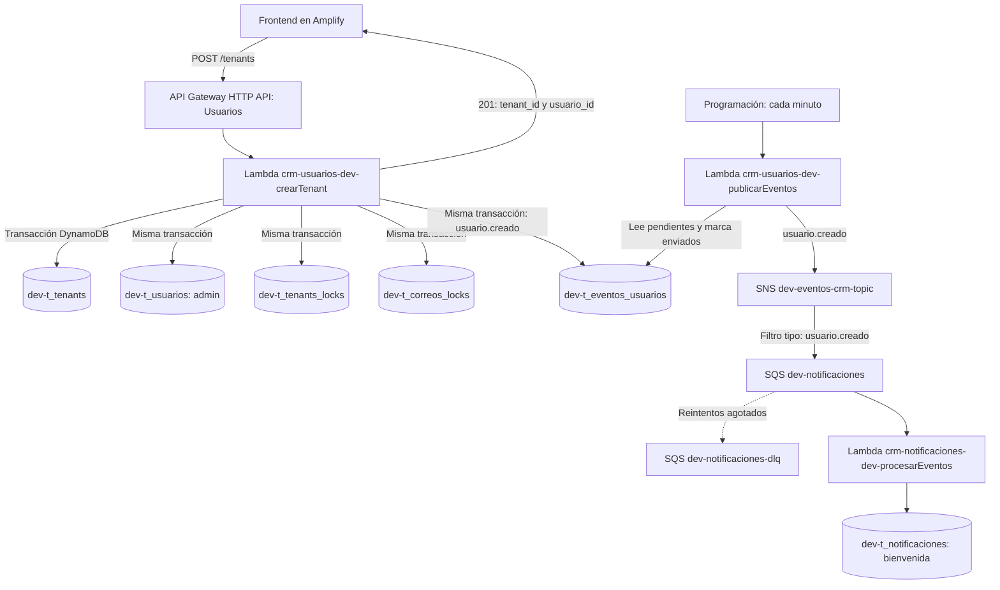
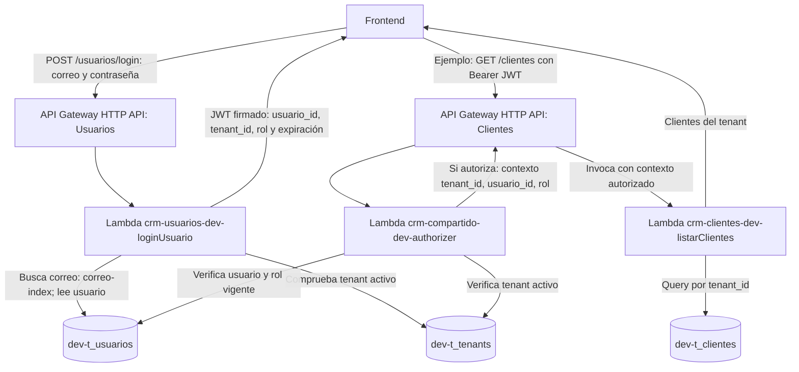
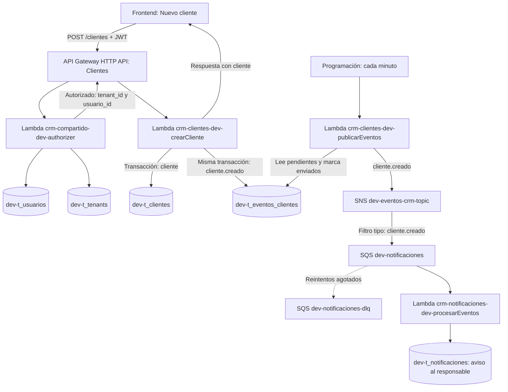
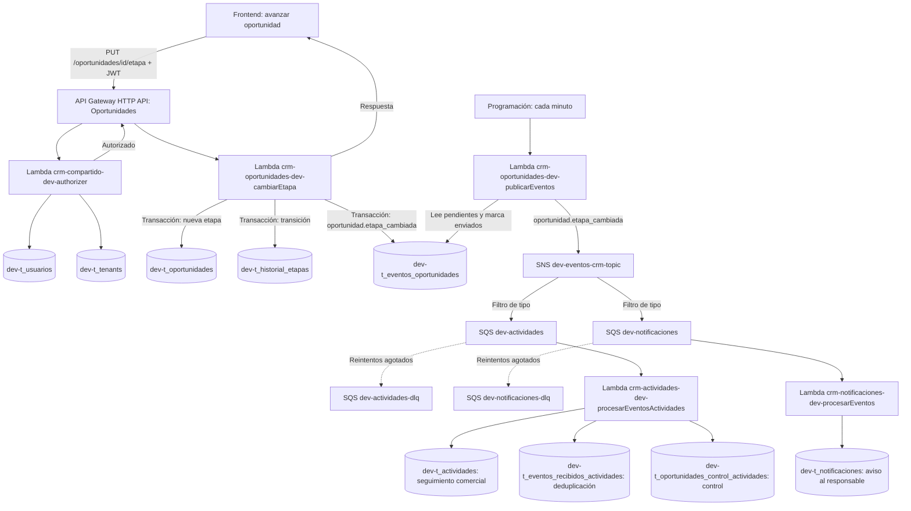
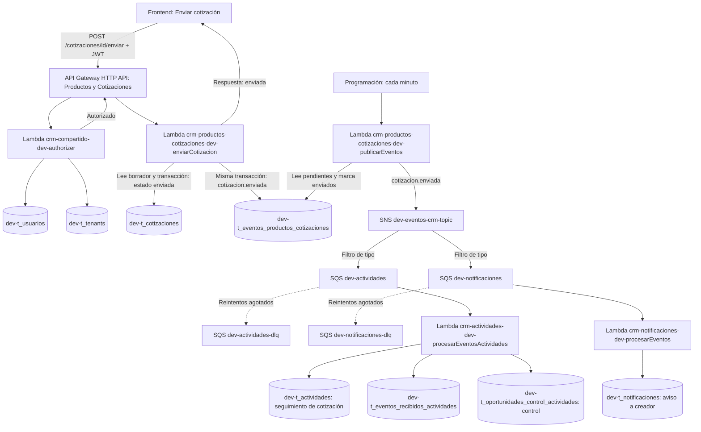

# Arquitectura de solución: seis flujos principales

Referencia para la exposición del entorno `dev`, región `us-east-1`. Los nombres provienen de la configuración y la guía del repositorio; comprueba la cuenta y el despliegue activo en AWS. Las flechas muestran intervenciones, no necesariamente una invocación directa. Los flujos 1 y 3–4 incluyen procesos asíncronos.

## 1. Registro de empresa y bienvenida

La transacción guarda las cinco piezas juntas. Los candados evitan nombres y correos duplicados. El evento lleva `tenant_id`, `evento_id` y datos del usuario. `enviado` en el outbox indica que SNS aceptó la publicación; comprueba la notificación para acreditar el resultado posterior. En la consola, busca el tenant por nombre en `dev-t_tenants`, usa su `tenant_id` para encontrar el admin y filtra el outbox por ese tenant. Relaciona el evento con la notificación mediante `evento_id`.

## 2. Inicio de sesión y acceso protegido

El login es público. El Authorizer valida firma y vencimiento del JWT y verifica el estado actual del usuario y del tenant en DynamoDB. El listado usa el `tenant_id` del contexto autorizado. Para demostrar aislamiento, entra con dos tenants y compara sus listas con los registros de `dev-t_clientes`; una prueba adicional de acceso directo a un ID ajeno aporta evidencia más fuerte. No compartas JWT ni contraseñas en la exposición.

## 3. Crear cliente y notificar al responsable

En DynamoDB identifica el cliente por `tenant_id` y `cliente_id`. En el outbox busca `cliente.creado` con ese `cliente_id`; relaciona su `evento_id` con la notificación. La creación de un contacto es otra operación y no publica un evento en la implementación actual.

## 4. Cambiar etapa de oportunidad y generar seguimiento

Este ejemplo presupone una oportunidad existente y la transición de `nueva` a `calificada`.

Busca la oportunidad y su historial por `tenant_id` y `oportunidad_id`. En el outbox anota el `evento_id`; úsalo para encontrar el registro recibido por Actividades, el `evento_origen_id` de la tarea y la notificación. Las dos ramas consumen el evento de manera independiente y pueden terminar en momentos distintos.

## 5. Enviar una cotización y generar seguimiento

Se parte de una cotización en `borrador`, asociada a una oportunidad y creada previamente con productos.

Busca `cotizacion_id` y `estado: enviada` en `dev-t_cotizaciones`. En el outbox busca `cotizacion.enviada` con ese ID y usa su `evento_id` para relacionarlo con la tarea y la notificación. Enviar cambia el estado dentro del CRM y genera eventos; este flujo no acredita el envío de un correo externo.

## 6. Aceptar cotización y ganar oportunidad

Se parte de una cotización `enviada` y una oportunidad abierta. La aceptación se confirma de forma asíncrona entre dos servicios.

```mermaid
flowchart TD
 F[Frontend: Aceptar] -->|POST /cotizaciones/id/aceptar + JWT| API[API Gateway: Productos y Cotizaciones]
 API --> A[Lambda crm-compartido-dev-authorizer]
 A --> U[(dev-t_usuarios)]
 A --> T[(dev-t_tenants)]
 A -->|Autorizado| API
 API --> L[Lambda crm-productos-cotizaciones-dev-aceptarCotizacion]
 L -->|Transacción: aceptacion_pendiente| C[(dev-t_cotizaciones)]
 L -->|Transacción: cotizacion.aceptacion_solicitada| OC[(dev-t_eventos_productos_cotizaciones)]
 L -->|HTTP 202: pendiente| F
 EC[Programación: cada minuto] --> PC[Lambda crm-productos-cotizaciones-dev-publicarEventos]
 PC -->|Lee y marca enviados| OC
 PC --> SNS[SNS dev-eventos-crm-topic]
 SNS -->|cotizacion.aceptacion_solicitada| QS[SQS ColaSolicitudAceptacion]
 QS -.-> DS[SQS ColaSolicitudAceptacionDLQ]
 QS --> LO[Lambda crm-oportunidades-dev-procesarSolicitudAceptacion]
 LO -->|Consulta y, si confirma, marca ganada| OP[(dev-t_oportunidades)]
 LO -->|Si confirma: historial| H[(dev-t_historial_etapas)]
 LO -->|Guarda decisión por solicitud_id| SOL[(dev-t_solicitudes_aceptacion)]
 LO -->|Confirmada o rechazada; si confirma también oportunidad.ganada| OO[(dev-t_eventos_oportunidades)]
 EO[Programación: cada minuto] --> PO[Lambda crm-oportunidades-dev-publicarEventos]
 PO -->|Lee y marca enviados| OO
 PO --> SNS
 SNS -->|oportunidad.aceptacion_confirmada o rechazada| QR[SQS ColaResultadoAceptacion]
 QR -.-> DR[SQS ColaResultadoAceptacionDLQ]
 QR --> LR[Lambda crm-productos-cotizaciones-dev-procesarResultadoAceptacion]
 LR -->|Confirmada: aceptada; rechazada: enviada| C
 LR -->|Solo si confirma: cotizacion.aceptada| OC
 SNS -->|oportunidad.ganada| QA[SQS dev-actividades]
 QA --> LA[Lambda crm-actividades-dev-procesarEventosActividades]
 LA --> ACT[(dev-t_actividades)]
 LA --> REC[(dev-t_eventos_recibidos_actividades)]
 LA --> CTRL[(dev-t_oportunidades_control_actividades)]
 SNS -->|oportunidad.ganada y cotizacion.aceptada| QN[SQS dev-notificaciones]
 QN --> LN[Lambda crm-notificaciones-dev-procesarEventos]
 LN --> NOT[(dev-t_notificaciones)]
 SNS -->|cotizacion.aceptada| QOLD[SQS dev-oportunidades-cotizacion-aceptada]
 QOLD --> OLD[Lambda crm-oportunidades-dev-procesarCotizacionAceptada]
 OLD --> OP
 QA -.-> DA[SQS dev-actividades-dlq]
 QN -.-> DN[SQS dev-notificaciones-dlq]
 QOLD -.-> DOLD[SQS dev-oportunidades-cotizacion-aceptada-dlq]
```

En el despliegue documentado, las colas de solicitud y resultado se llamaban `crm-oportunidades-dev-ColaSolicitudAceptacion-hVGkaPrgl25g` y `crm-productos-cotizaciones-dev-ColaResultadoAceptacion-MSkFc1tIUVS3`. Sus DLQ tenían los sufijos `6sY06hBRRkrb` y `KtVFaPpYQeor`, respectivamente. Como sus nombres físicos pueden cambiar, consulta en CloudFormation los recursos `ColaSolicitudAceptacion`, `ColaSolicitudAceptacionDLQ`, `ColaResultadoAceptacion` y `ColaResultadoAceptacionDLQ` en los stacks correspondientes.

Para seguir una ejecución, anota `solicitud_aceptacion_id` en la cotización y búscalo como `solicitud_id` en `dev-t_solicitudes_aceptacion` y los eventos. Una respuesta 202 solo indica que la solicitud quedó pendiente. Si se confirma, comprueba oportunidad `ganada` y cotización `aceptada`; si se rechaza, la cotización vuelve a `enviada` con el motivo. Las ramas de actividades y avisos ocurren después y se procesan de forma independiente. El consumidor anterior de `cotizacion.aceptada` conserva su propia cola; en el flujo nuevo la oportunidad debería estar ya ganada.

## Cómo observarlo en AWS

- **API Gateway:** identifica las HTTP API de cada servicio y sus rutas; los nombres físicos se pueden localizar en CloudFormation, en los stacks `crm-usuarios-dev`, `crm-clientes-dev` y `crm-oportunidades-dev`.
- **Lambda:** busca los nombres indicados; en **Monitor → CloudWatch logs** revisa ejecuciones y errores.
- **DynamoDB:** entra en **Tables → Explore table items**. Para tablas con `tenant_id` como clave utiliza Query; para encontrar un evento sin conocer su `evento_id`, usa Scan con filtro por `tenant_id`.
- **SNS:** abre `dev-eventos-crm-topic` y revisa sus suscripciones y filtros. Sus métricas son agregadas y SNS no es una bandeja histórica de eventos.
- **SQS:** una cola vacía puede significar que Lambda procesó el mensaje rápidamente. Revisa también su DLQ y los registros de destino.
- **Evidencia:** estos diagramas representan el código y configuración del repositorio; anota fecha, cuenta, región, identificadores y resultados al ejecutar cada caso. La existencia de recursos y el resultado en AWS deben comprobarse en el entorno activo.
